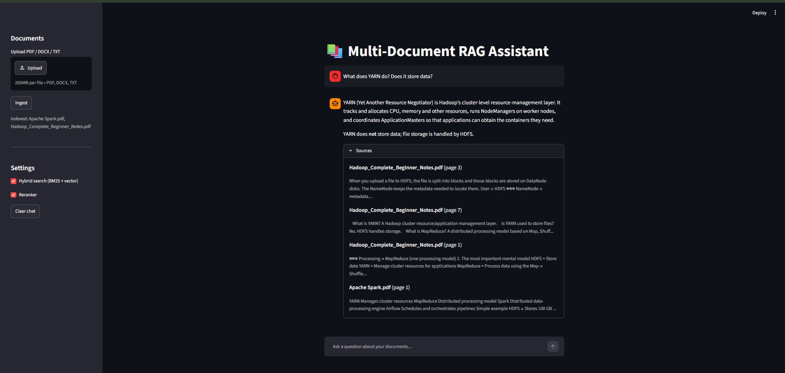
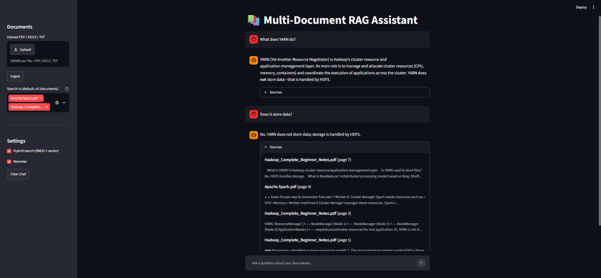

# Multi-Document RAG Assistant

Ask questions across multiple PDF, DOCX and TXT files and get answers with source citations (file name and page number). The assistant answers only from your documents and says "I don't know" when the answer is not there.

## Features

- Upload PDF, DOCX and TXT files from the UI and index them instantly
- Hybrid retrieval: vector search (semantic) + BM25 (keyword), merged with Reciprocal Rank Fusion
- Cross-encoder reranker (bge-reranker-base)
- Follow-up questions: the question is rewritten as a standalone query using chat history
- Source citations with file name, page and snippet
- Choose which documents to search in (multi-select, default: all documents)
- FastAPI backend with /ask, /upload, /sources and /health endpoints
- Streamlit chat UI
- Automated tests (pytest)

## Architecture

    Upload -> Load (PyPDF/Docx/Text) -> Chunk (700 chars, 100 overlap)
           -> Embeddings (bge-small-en-v1.5) -> ChromaDB

    Question -> Rewrite using chat history
             -> Vector search (top 20) + BM25 (top 20)
             -> Reciprocal Rank Fusion
             -> Cross-encoder rerank
             -> LLM (Groq) -> Answer + Sources

    Streamlit UI  <->  FastAPI  <->  RAG pipeline

## Tech Stack

Python, LangChain, ChromaDB, sentence-transformers, rank_bm25, Groq (openai/gpt-oss-120b), FastAPI, Streamlit, pytest

## Project Structure

    app/
      ingest.py        load files and split into chunks
      vectorstore.py   embeddings and ChromaDB
      retriever.py     hybrid search and reranking
      generator.py     LLM answer, history and citations
      api.py           FastAPI endpoints
    ui/
      streamlit_app.py chat interface
    tests/
      test_basic.py    unit and API tests

## Run Locally

1. Create and activate a virtual environment

        python -m venv venv
        venv\Scripts\activate

2. Install dependencies

        pip install -r requirements.txt

3. Create a .env file with your free Groq API key

        GROQ_API_KEY=your_key_here

4. Start the API (terminal 1)

        uvicorn app.api:app --reload --reload-dir app

5. Start the UI (terminal 2)

        streamlit run ui/streamlit_app.py

6. Open http://localhost:8501, upload documents in the sidebar and click Ingest.

## Run Tests

    pytest -q

## API

- POST /upload : upload and index a document
- POST /ask : ask a question (supports chat history)
- GET /sources : list indexed documents
- GET /health : health check

Interactive docs at http://localhost:8000/docs

## Screenshots

